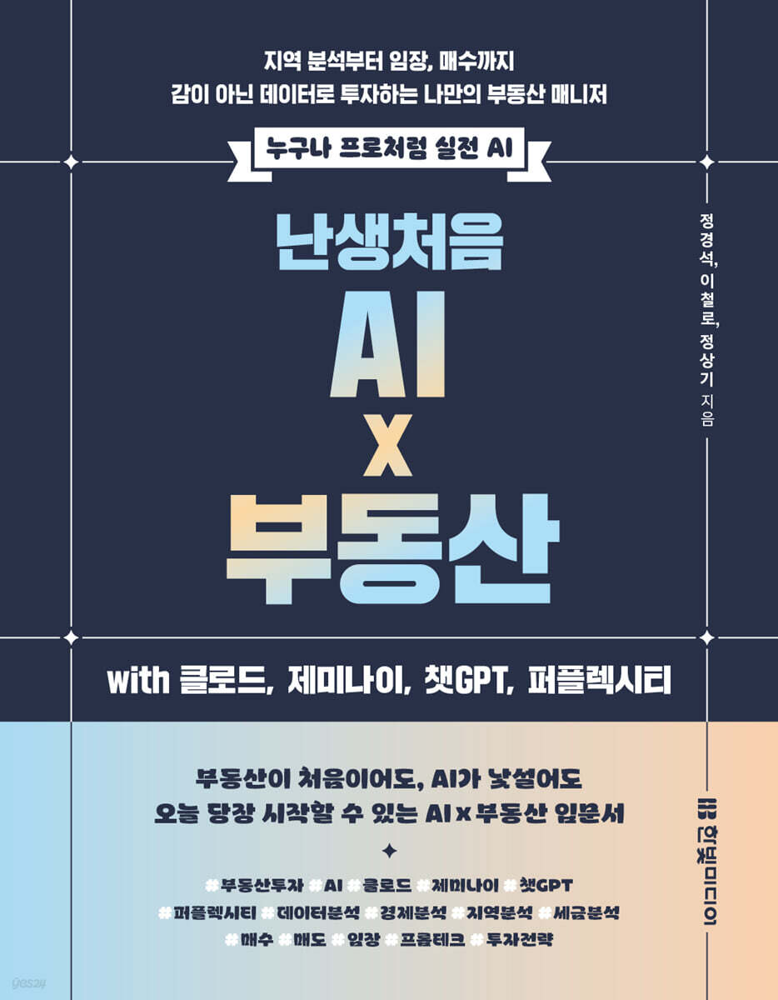

# 『AI 부동산 투자』 프롬프트 저장소

[『난생처음 AI × 부동산』 도서 소개 · YES24](https://www.yes24.com/product/goods/197068685)

Uploading book-promo-route-10s.mp4…

이 저장소는 책 **『AI 부동산 투자』**(정케빈·지피타쿠·푸디 공저)에 수록된 **38개 실습 프롬프트**와 **AI 맞춤 지침 템플릿**을 담고 있습니다. `prompts-txt/`에는 TXT 원본을 보존하고, `prompts-md/`에는 읽기·편집과 이후 개선을 위한 Markdown 버전을 정리합니다. 프롬프트를 복사해 AI(챗GPT·클로드·제미나이 등)에 붙여 넣어 사용하세요.

> ⚠️ **꼭 읽어주세요 — ‘시점중립’ 사용법**
>
> 이 프롬프트들은 특정 시점의 세율·날짜를 외우게 하지 않고, **실행하는 그날의 최신
> 기준을 AI가 직접 조회·검증하도록** 설계돼 있습니다. 프롬프트 안의 `[현재연도]`,
> `[현재월]` 같은 변수와 규제·세율 수치(LTV·DSR·양도세 등)는 **반드시 실행 시점에
> 공식 원문으로 재확인**하세요. 2026년 세제개편안 관련 수치는 **국회 확정 전 발표안
> 기준**이며, 확정 시 달라질 수 있습니다. 자세한 내용은 [`docs/시점중립_안내.md`](docs/시점중립_안내.md).

## 사용법

1. **먼저** `prompts-txt/Chapter 01 AI 투자 비서 만들기/AI 맞춤 지침 템플릿.txt` 또는 `prompts-md/`의 같은 챕터에 있는 지침 템플릿을 AI 프로젝트(또는 제미나이 Gem)의 지침란에 붙여 넣고, `[대괄호]` 안을 내 정보로 바꿉니다.
2. 아래 챕터 목차에서 해당 실습을 찾아 `.txt` 전체 또는 `.md`의 제목 아래 본문을 복사해 새 대화창에 붙여 넣습니다.
3. AI가 최신 데이터를 조회한 뒤 정해진 출력 형식으로 분석해 줍니다.
4. 변수 표기 규칙은 [`docs/변수표기_규칙.md`](docs/변수표기_규칙.md)를 참고하세요.

## 프롬프트 폴더 구성

두 폴더는 동일한 10개 챕터 구조로 구성되며, 각각 실습 38개와 AI 맞춤 지침 템플릿 1개를 담고 있습니다. 전체 Markdown 파일은 [Markdown 프롬프트 목차](prompts-md/README.md)에서 바로 찾아갈 수 있습니다.

- **[`prompts-txt/`](prompts-txt/)**: 책의 TXT 원본을 보존합니다. 기존 챕터명·파일명·본문을 유지합니다.
- **[`prompts-md/`](prompts-md/README.md)**: 제목·구역·목록·표를 Markdown으로 정리한 버전입니다. 앞으로 프롬프트를 개선하거나 확장할 때는 이 폴더에서 작업합니다.
- 두 버전은 자동으로 동기화되지 않습니다. Markdown의 개선 내용을 TXT 원본에 자동 반영하지 않으며, 원본 보존과 이후 개선을 구분합니다.

## 목차 (10개 챕터 · 38실습 + 지침 템플릿)

| 챕터 | TXT 원본 | Markdown | 수록 |
|---|---|---|---|
| Chapter 01 AI 투자 비서 만들기 | [TXT](<prompts-txt/Chapter 01 AI 투자 비서 만들기/>) | [MD](<prompts-md/Chapter 01 AI 투자 비서 만들기/>) | AI 맞춤 지침 템플릿 |
| Chapter 02 거시 경제 분석 | [TXT](<prompts-txt/Chapter 02 거시 경제 분석/>) | [MD](<prompts-md/Chapter 02 거시 경제 분석/>) | 실습 01~03 |
| Chapter 03 미시 경제 분석 | [TXT](<prompts-txt/Chapter 03 미시 경제 분석/>) | [MD](<prompts-md/Chapter 03 미시 경제 분석/>) | 실습 04~06 |
| Chapter 04 정책·세금 분석 | [TXT](<prompts-txt/Chapter 04 정책·세금 분석/>) | [MD](<prompts-md/Chapter 04 정책·세금 분석/>) | 실습 07~09 |
| Chapter 05 투자 전략 수립 | [TXT](<prompts-txt/Chapter 05 투자 전략 수립/>) | [MD](<prompts-md/Chapter 05 투자 전략 수립/>) | 실습 10~14 |
| Chapter 06 지역 분석 | [TXT](<prompts-txt/Chapter 06 지역 분석/>) | [MD](<prompts-md/Chapter 06 지역 분석/>) | 실습 15~21 |
| Chapter 07 단지 분석 | [TXT](<prompts-txt/Chapter 07 단지 분석/>) | [MD](<prompts-md/Chapter 07 단지 분석/>) | 실습 22~25 |
| Chapter 08 임장·의사 결정 | [TXT](<prompts-txt/Chapter 08 임장·의사 결정/>) | [MD](<prompts-md/Chapter 08 임장·의사 결정/>) | 실습 26~28 |
| Chapter 09 매수 실전(갈아타기) | [TXT](<prompts-txt/Chapter 09 매수 실전(갈아타기)/>) | [MD](<prompts-md/Chapter 09 매수 실전(갈아타기)/>) | 실습 29~33 |
| Chapter 10 매도 실전 | [TXT](<prompts-txt/Chapter 10 매도 실전/>) | [MD](<prompts-md/Chapter 10 매도 실전/>) | 실습 34~38 |

## 지원 AI

챗GPT · 클로드 · 제미나이 · 퍼플렉시티 · 코멧 — 동일 프롬프트로 사용할 수 있습니다.
(생성 AI 특성상 같은 프롬프트라도 응답은 매번 다를 수 있습니다. 책의 응답을 그대로
재현하는 것이 아니라 분석의 구조와 흐름을 익히는 것이 목적입니다.)

## 대응 원고 버전

- 대응 원고: 『AI 부동산 투자』 (원고 v1.5 기준)
- 변경 이력: [`CHANGELOG.md`](CHANGELOG.md)

## 저작권 및 이용 범위

© 2026 정케빈 · 지피타쿠(이철로) · 푸디(정상기). All rights reserved.

본 저장소의 프롬프트는 책의 부속 자료로, **크리에이티브 커먼즈 저작자표시-비영리-변경금지
4.0 (CC BY-NC-ND 4.0)** 조건으로 제공됩니다. 개인 학습·실습 목적의 이용은 자유이나,
**상업적 이용·2차적 변경물 배포·무단 재판매를 금지**합니다. 자세한 내용은
[`LICENSE`](LICENSE)를 참고하세요.

## 오탈자·오류 제보

프롬프트의 오탈자나 오류를 발견하시면 Issues로 남겨주세요. 규제·세율 수치는
"실행 시점 기준으로 재확인"이 전제이므로, 값 자체보다 **표기·구조·변수 오류** 제보를
환영합니다.
